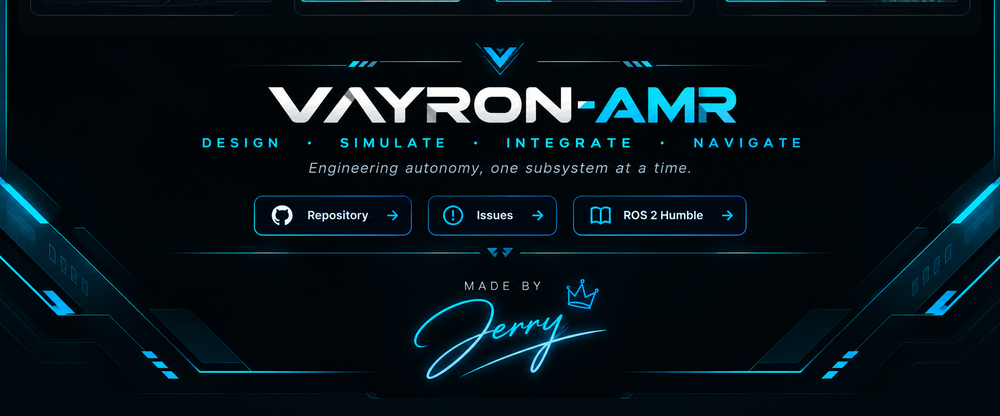

# VAYRON-AMR

**A compact four-wheel skid-steer autonomous mobile robot developed with ROS 2.**

VAYRON is a hands-on robotics project focused on bringing together mechanical design, embedded motor control, sensor integration and mobile robot software. The system is being developed around a Raspberry Pi running ROS 2 Humble, an Arduino Uno for low-level motor control, a four-wheel skid-steer chassis and a 2D LiDAR.

The repository contains the robot description, simulation and navigation packages, hardware interface code and Arduino firmware. The project is under active development; the status below separates what is present in the codebase from what has been verified on the physical robot.

<div align="center">
  
</div>

<p align="center">
  <a href="https://docs.ros.org/en/humble/"></a>
  <a href="https://releases.ubuntu.com/22.04/"></a>
  
  
  
  
</p>

---

## Contents

- [Project at a glance](#project-at-a-glance)
- [Design and hardware](#design-and-hardware)
- [Mechanical reference dimensions](#mechanical-reference-dimensions)
- [Software architecture](#software-architecture)
- [Repository layout](#repository-layout)
- [Development status](#development-status)
- [Requirements](#requirements)
- [Getting started](#getting-started)
- [Build the workspace](#build-the-workspace)
- [Simulation](#simulation)
- [ROS 2 topics and interfaces](#ros-2-topics-and-interfaces)
- [Physical hardware connection](#physical-hardware-connection)
- [Mapping and navigation](#mapping-and-navigation)
- [Safety and testing notes](#safety-and-testing-notes)
- [Known limitations and next steps](#known-limitations-and-next-steps)
- [Contributing](#contributing)
- [Project author](#project-author)

## Project at a glance

VAYRON uses a conventional four-wheel layout. The two wheels on the left side are controlled as one drive group, and the two wheels on the right side form the other. Steering is achieved by varying the speed and direction of the left and right sides.

The software is organized as a ROS 2 workspace so that the robot model, simulation, teleoperation, control, hardware communication, perception and navigation can be developed independently.

The intended development path is:

1. Build and validate the mechanical platform.
2. Maintain a matching URDF/Xacro model.
3. Test drive behaviour and sensor placement in Gazebo.
4. Establish reliable command transfer between ROS 2 and the Arduino.
5. Bring up the physical LiDAR and other sensors.
6. Validate odometry, mapping and localization.
7. Integrate Nav2 and test autonomous movement in a controlled environment.

## Design and hardware

The following list describes the VAYRON prototype configuration and the components represented in the current robot model. It is not a substitute for checking the physical wiring, exact part revisions or electrical ratings before powering the robot.

| Component | Prototype configuration | Role |
|---|---|---|
| Main computer | Raspberry Pi 4B, 4 GB RAM | Runs Ubuntu/Linux and ROS 2 |
| Microcontroller | Arduino Uno | Low-level motor-control interface |
| Motor driver | L298N dual H-bridge | Drives the left and right motor groups |
| Drive system | Four geared DC motors | Four-wheel skid-steer movement |
| Range sensor | Slamtec RPLIDAR C1 | 2D range data for perception and mapping |
| Digital sensor | HW-201 module | Additional digital sensing; its final use and placement should match the wiring |
| Storage | 32 GB microSD card | Raspberry Pi operating system and project files |
| Cooling | Raspberry Pi cooling fan | Helps manage board temperature |
| Chassis | Three-level plate layout in the current CAD/URDF model | Supports electronics and mechanical assemblies |
| Wheels | Four conventional wheels | Ground contact and traction |

**Electrical note:** Motor supply, logic supply and Raspberry Pi power must be designed as separate, correctly regulated rails where required. Confirm the battery chemistry and series/parallel arrangement, motor stall current, driver current limits, polarity and common-ground arrangement from the actual hardware before connecting power. Do not infer a safe battery voltage from a cell label alone.

### Drive configuration

VAYRON is a four-wheel differential/skid-steer platform, not a mecanum robot.

- Left-front and left-rear wheels form the left drive group.
- Right-front and right-rear wheels form the right drive group.
- Forward and reverse motion use the same direction on both sides.
- Turning is produced by commanding different speeds, or opposite directions, on the two sides.

The current Arduino sketch uses the two channels of an L298N driver. Its pin assignments are documented in the firmware and must be checked against the physical wiring before use.

## Mechanical reference dimensions

The current Xacro model contains the following reference geometry:

| Parameter | Value |
|---|---:|
| Chassis length | 257 mm |
| Chassis width | 150 mm |
| Chassis plate thickness | 3 mm |
| Wheel diameter | 67.25 mm |
| Wheel width | 20.19 mm |
| Wheelbase (front-to-rear wheel centre distance) | 130.17 mm |
| Track width (left-to-right wheel centre distance) | 117.13 mm |
| Chassis arrangement | Three plate levels |

These values describe the robot model in the repository. Treat them as design references until they have been checked against the assembled chassis. CAD visuals and URDF geometry are still being refined, so the model should not yet be treated as a manufacturing drawing.

## Software architecture

The Raspberry Pi is intended to run the high-level ROS 2 system. The Arduino handles the time-sensitive motor-driver signals. ROS 2 velocity commands pass through a watchdog and the serial bridge before reaching the microcontroller.

```text
                 Teleoperation / Nav2
                         |
                         v
                      /cmd_vel
                         |
                         v
                Command velocity watchdog
                         |
                         v
                   /cmd_vel_safe
                         |
                         v
                 Raspberry Pi serial bridge
                         |
                    USB serial link
                         |
                         v
                    Arduino Uno
                         |
                         v
                     L298N
                         |
                Four DC geared motors


 RPLIDAR C1 --------------------> LaserScan
 Digital sensor ----------------> Sensor input
 Robot description -------------> Robot links and TF
```

The diagram describes the intended system data flow. Individual interfaces are still being integrated and validated; the presence of a node or configuration file does not by itself mean the complete hardware path is operational.

### ROS 2 packages

| Package | Responsibility |
|---|---|
| `vayron_description` | URDF/Xacro model, robot state publishing and RViz configuration |
| `vayron_simulation` | Gazebo Classic worlds, simulated sensors and drive plugin configuration |
| `vayron_bringup` | Launch coordination for robot subsystems |
| `vayron_control` | Velocity watchdog and control-side utilities |
| `vayron_hardware` | Raspberry Pi-to-Arduino serial communication and hardware feedback |
| `vayron_navigation` | SLAM Toolbox and Nav2 launch/configuration files |
| `vayron_perception` | Sensor and perception configuration |
| `vayron_teleop` | Teleoperation package |

The repository also includes the Slamtec `sllidar_ros2` driver under `src/`.

## Repository layout

The main project files are organized as follows:

```text
VAYRON-AMR/
├── docs/
│   ├── architecture/
│   └── images/
│       └── vayron-header-banner.png
├── firmware/
│   └── arduino_uno/
│       └── vayron_motor_controller.ino
├── maps/
│   ├── sample.pgm
│   └── sample.yaml
├── src/
│   ├── sllidar_ros2/
│   ├── vayron_bringup/
│   ├── vayron_control/
│   ├── vayron_description/
│   ├── vayron_hardware/
│   ├── vayron_navigation/
│   ├── vayron_perception/
│   ├── vayron_simulation/
│   └── vayron_teleop/
└── README.md
```

## Development status

Status is intentionally conservative. The table reflects repository contents and the latest recorded checks, not an assumption that every subsystem is ready for regular operation.

| Area | Current state | Notes |
|---|---|---|
| ROS 2 workspace | In place | Workspace and project packages are maintained in this repository |
| Robot description | In progress | Three-level chassis, four wheels, electronics, shell and LiDAR are represented in Xacro; visual and TF validation remains |
| Gazebo simulation | Implemented in repository; validation ongoing | Indoor and city world launch files and simulated drive/LiDAR plugins are present |
| Velocity watchdog | Implemented | Relays `/cmd_vel` to `/cmd_vel_safe`, limits commands and publishes zero velocity after timeout |
| Arduino firmware | Present; hardware validation required | Accepts left/right motor commands over serial and has a command timeout |
| Raspberry Pi serial bridge | Present; end-to-end operation not yet confirmed | Reconnect handling, command transfer and feedback parsing are implemented in the code |
| Physical Arduino connection | Device path identified | A stable `/dev/vayron_arduino` symlink was observed pointing to `/dev/ttyUSB0` on 24 November 2026 |
| RPLIDAR C1 | Physical data observed previously | Physical scan data was handled separately from Gazebo scan data; frame and configuration checks remain |
| Odometry | Preliminary only | Current serial bridge publishes command-derived odometry, not encoder-calibrated wheel odometry |
| SLAM and Nav2 | Configuration present; validation pending | Requires reliable TF, sensor frames, odometry and localization before autonomous tests |
| RViz model | In progress | Link geometry, wheel transforms and the rendered appearance still need checking |

**Latest recorded runtime check (24 November 2026):** the ROS 2 node list showed `/vayron_cmd_vel_watchdog`. The Arduino device symlink existed, but that check did not establish that the serial bridge, motor control and complete physical navigation chain were running together.

## Requirements

The documented software environment is:

- Ubuntu 22.04
- ROS 2 Humble
- Python 3
- `colcon`
- `rosdep`
- Git
- Gazebo Classic and its ROS 2 integration packages
- RViz2
- SLAM Toolbox and Nav2 for navigation work

The Raspberry Pi 4B is the intended onboard computer. A separate Ubuntu machine can also be used for development and simulation.

Check the ROS environment:

```bash
printenv ROS_DISTRO
which ros2
```

The expected ROS distribution is `humble`.

## Getting started

Clone the repository into a workspace directory. The repository itself is the workspace root; do not clone it into another workspace's `src/` directory.

```bash
cd ~
git clone https://github.com/shivamsb22/VAYRON-AMR.git
cd ~/VAYRON-AMR
```

Source ROS 2:

```bash
source /opt/ros/humble/setup.bash
```

Install dependencies:

```bash
sudo apt update
sudo apt install -y python3-colcon-common-extensions python3-rosdep
]

If `rosdep` has not been initialized on the machine:

```bash
sudo rosdep init
rosdep update
```

Resolve package dependencies from the repository:

```bash
cd ~/VAYRON-AMR
rosdep install --from-paths src --ignore-src -r -y
```

If `rosdep init` reports that it has already been initialized, continue with `rosdep update`.

## Build the workspace

```bash
cd ~/VAYRON-AMR
source /opt/ros/humble/setup.bash
colcon build --symlink-install
```

After a successful build:

```bash
source ~/VAYRON-AMR/install/setup.bash
```

For each new terminal:

```bash
source /opt/ros/humble/setup.bash
source ~/VAYRON-AMR/install/setup.bash
```

Check that the packages are discoverable:

```bash
ros2 pkg list | grep '^vayron_'
```

If a package fails to build, fix the first relevant error before launching dependent packages.

## Simulation

The repository includes Gazebo Classic launch files for an indoor test environment and a city environment. Build the workspace and source both ROS 2 and the workspace overlay before launching.

Indoor environment:

```bash
ros2 launch vayron_simulation vayron_indoor.launch.py
```

City environment:

```bash
ros2 launch vayron_simulation city.launch.py
```

A general simulation launch file is also available:

```bash
ros2 launch vayron_simulation simulation.launch.py
```

The exact launch arguments and installed dependencies should be checked in the relevant launch file. In a second terminal, inspect the running graph:

```bash
ros2 node list
ros2 topic list
ros2 topic info /cmd_vel_safe
ros2 topic info /scan
```

The simulation drive and LiDAR plugins are configured in the robot description for simulation mode. Confirm the robot spawns, the wheel joints update, and the scan frame is available before using the simulation for navigation tests.

## ROS 2 topics and interfaces

The following names are used by the current code/configuration. Availability depends on which nodes are running.

| Topic | Message type | Purpose |
|---|---|---|
| `/cmd_vel` | `geometry_msgs/msg/Twist` | Incoming velocity command |
| `/cmd_vel_safe` | `geometry_msgs/msg/Twist` | Watchdog-filtered velocity command |
| `/odom` | `nav_msgs/msg/Odometry` | Preliminary odometry output |
| `/scan` | `sensor_msgs/msg/LaserScan` | Simulated LiDAR scan |
| `/scan_real` | `sensor_msgs/msg/LaserScan` | Physical LiDAR scan topic used in testing |
| `/joint_states` | `sensor_msgs/msg/JointState` | Joint state data, when published |
| `/tf` | `tf2_msgs/msg/TFMessage` | Transform tree |

Useful checks:

```bash
ros2 node list
ros2 topic list
ros2 topic info /cmd_vel
ros2 topic info /cmd_vel_safe
ros2 topic echo /scan_real
ros2 topic echo /odom
ros2 run tf2_tools view_frames
```

Do not assume that a topic is active simply because it appears in this table. Check the live ROS graph and the relevant launch configuration.

## Physical hardware connection

### Arduino firmware

The Arduino sketch is located at:

```text
firmware/arduino_uno/vayron_motor_controller.ino
```

The current serial protocol is line-based:

```text
M,<left_speed>,<right_speed>
```

Each side accepts a normalized speed between `-1.0` and `1.0`. The sketch uses a baud rate of 115200 and stops the motor outputs when valid commands are no longer received within its 500 ms timeout.

The firmware pin map is documented at the top of the sketch. Check it against the actual L298N wiring before uploading or applying motor power.

### Raspberry Pi serial bridge

The ROS 2 serial bridge is located at:

```text
src/vayron_hardware/vayron_hardware/serial_bridge.py
```

It subscribes to a configurable velocity topic (currently `/cmd_vel_safe` by default), converts linear and angular velocity into left/right drive commands and sends them to the Arduino over USB serial.

The bridge currently defaults to `/dev/ttyACM0`. If the system uses the persistent device name `/dev/vayron_arduino`, configure the bridge's `port` parameter accordingly. Confirm the device name with:

```bash
ls -l /dev/vayron_arduino
ls -l /dev/ttyUSB*
ls -l /dev/ttyACM*
```

The current code also publishes preliminary odometry from commanded velocity. This is useful for early integration checks, but it is not a replacement for calibrated wheel-encoder feedback. The single digital pulse input in the current firmware must not be treated as complete four-wheel odometry.

## Mapping and navigation

The repository contains launch and configuration files for SLAM Toolbox and Nav2.

Relevant launch files include:

- `slam.launch.py`
- `mapping_navigation.launch.py`
- `localization.launch.py`
- `navigation.launch.py`
- `saved_map_navigation.launch.py`

A sample map is stored in:

```text
maps/sample.yaml
maps/sample.pgm
```

Before running SLAM, verify that the physical LiDAR publishes a valid `sensor_msgs/msg/LaserScan`, the scan frame exists in TF, and the robot base transforms are connected correctly.

For navigation, also verify:

- The map loads with the correct resolution and origin.
- Localization publishes the expected map-to-odom transform.
- Odometry is stable and uses the correct frames.
- Costmaps receive valid obstacle data.
- Nav2 lifecycle nodes and action servers become active.
- Velocity commands reach the intended controller.

The launch/configuration files are a starting point for integration. Autonomous navigation should be considered experimental until these checks pass on the physical robot.

## Safety and testing notes

A software timeout is only one layer of protection. It does not replace a physical emergency stop, appropriate fusing, current limiting or safe mechanical design.

Before testing the drive system:

1. Raise the chassis so the wheels cannot propel the robot unexpectedly.
2. Verify motor polarity and driver wiring with motor power disconnected.
3. Check the logic and motor supply voltages independently.
4. Confirm a common signal ground where required by the circuit.
5. Test each motor at low speed before testing the complete drive.
6. Verify that loss of serial communication stops the motor outputs.
7. Keep hands, cables and loose objects clear of wheels and gears.
8. Test autonomous behaviour only in a controlled area with a reachable physical stop.

Never connect a motor supply directly to the Raspberry Pi power input or assume that the L298N's onboard regulator is an appropriate Raspberry Pi power source.

## Known limitations and next steps

The following work remains important before VAYRON can be considered a dependable autonomous mobile robot:

- [ ] Reconcile the URDF geometry with the finished physical chassis and verify the full TF tree.
- [ ] Correct and calibrate the serial bridge's wheel geometry parameters against the actual robot.
- [ ] Validate Arduino-to-Raspberry Pi serial communication from startup through shutdown.
- [ ] Verify the motor driver pin map, motor direction and safe-stop behaviour on the assembled robot.
- [ ] Establish reliable wheel-motion feedback and calibrated odometry.
- [ ] Confirm the RPLIDAR C1 driver settings, scan topic and sensor frame.
- [ ] Resolve RViz model and wheel-transform issues.
- [ ] Validate SLAM mapping with the physical robot.
- [ ] Tune localization, costmaps, planner and controller settings for Nav2.
- [ ] Run repeatable navigation tests and document the results.

Issues should be marked complete only after a repeatable test has been performed and its result recorded.

## Contributing

This is an actively developed engineering project. Suggestions, issue reports and improvements are welcome.

For code contributions:

1. Fork the repository.
2. Create a branch for one focused change.
3. Keep package responsibilities separate.
4. Build and test the affected package.
5. Include the commands used and the observed result in the pull request.

When reporting a hardware issue, include the board, driver, sensor revision, wiring changes and relevant ROS 2 logs. That makes debugging considerably more useful than a photograph of an error message with no context.

## Project author

**Designed and developed by Jerry**

VAYRON-AMR is an independent robotics development project covering mechanical design, embedded systems, ROS 2 integration, simulation and autonomous navigation.

[GitHub repository](https://github.com/shivamsb22/VAYRON-AMR)
