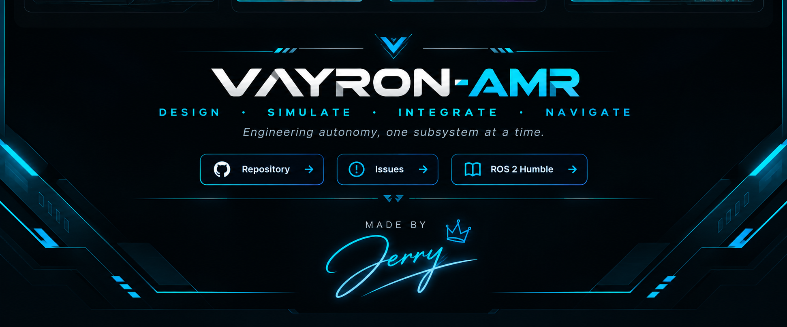

<div align="center">

# VAYRON-AMR

### Autonomous Mobile Robotics Platform

**Design · Simulate · Integrate · Navigate**

A modular four-wheel differential-drive Autonomous Mobile Robot project built with ROS 2.




</div>

---

## Contents

1. [Project Overview](#project-overview)
2. [Objectives](#objectives)
3. [Project Status](#project-status)
4. [Robot Specifications](#robot-specifications)
5. [Hardware Plan](#hardware-plan)
6. [Software Stack](#software-stack)
7. [System Architecture](#system-architecture)
8. [Workspace Structure](#workspace-structure)
9. [Installation](#installation)
10. [Build](#build)
11. [Launch and Usage](#launch-and-usage)
12. [Verification and Testing](#verification-and-testing)
13. [Development Roadmap](#development-roadmap)
14. [Troubleshooting](#troubleshooting)
15. [Engineering Principles](#engineering-principles)
16. [Contributing](#contributing)
17. [License](#license)

---

## 1. Project Overview

**VAYRON-AMR** is a modular robotics project focused on the development of a four-wheel differential-drive Autonomous Mobile Robot (AMR). The repository organizes robot description, simulation, control, hardware, navigation, and bringup into separate ROS 2 packages.

The project follows a **simulation-first workflow**: establish the robot model and launch integration, validate sensor data and coordinate frames, then develop motion control and autonomous navigation in measurable stages.

> **Development note:** A successful workspace build or a launch file existing in the repository does not automatically mean every subsystem is fully functional. This README distinguishes available files and initial integration from features that still need implementation or end-to-end testing.

## 2. Objectives

- Build a maintainable, modular ROS 2 workspace.
- Describe the robot using URDF and Xacro.
- Visualize the robot and its coordinate frames in RViz2.
- Simulate the robot in Gazebo Classic.
- Configure and validate simulated LiDAR data.
- Develop differential-drive motion control and a hardware interface.
- Integrate mapping, localization, and Nav2 navigation step by step.
- Keep setup instructions, configuration, and test results reproducible.

## 3. Project Status

| Subsystem | Current state | Notes |
|---|---|---|
| ROS 2 workspace | Created and build-tested | Six project packages are present. |
| Robot description | Initial implementation | URDF/Xacro and launch integration exist; complete geometry and TF validation remain. |
| Simulation | Initial integration | Indoor facility and city world launch files are available. |
| RViz2 | Included in launch configuration | Displays and Fixed Frame must be checked against the active TF tree. |
| Simulated LiDAR | Configured | Confirm the active scan topic and sensor frame at runtime. |
| Command watchdog | Present | Forwards `/cmd_vel` to `/cmd_vel_safe`; physical safety behavior still requires separate validation. |
| SLAM and map workflow | In progress | Configuration and launch files exist; full mapping workflow needs validation. |
| Localization and Nav2 | In progress | Configuration is present; end-to-end goal navigation is not yet confirmed. |
| Physical motor control | In development | Arduino model, firmware, and hardware interface require implementation and testing. |

## 4. Robot Specifications

| Property | Design / environment |
|---|---|
| Robot type | Autonomous Mobile Robot |
| Drive type | Four-wheel differential drive / skid-steer |
| Robot model | URDF / Xacro |
| Middleware | ROS 2 Humble |
| Operating system | Ubuntu 22.04 LTS |
| Simulation | Gazebo Classic |
| Visualization | RViz2 |
| Range sensing | Simulated LiDAR configuration |
| Low-level controller | Arduino board, exact model to be confirmed |
| Motor driver | Exact model to be confirmed |
| Drive motors | Four geared DC motors; final specifications to be verified |

## 5. Hardware Plan

The table below describes the current hardware plan, not a verified final bill of materials.

| Component | Purpose | Information still needed |
|---|---|---|
| Arduino board | Low-level motor-control interface | Board model and communication method |
| Motor driver | Drives the four motors | Model, continuous current, and peak current ratings |
| Four geared DC motors | Differential/skid-steer movement | Voltage, gear ratio, current, and encoder availability |
| LiDAR | Range sensing for perception and mapping | Physical sensor model and interface |
| Power system | Supplies motors and electronics | Voltage, current capacity, protection, and wiring design |

**Electrical safety:** Verify component datasheets, motor-driver ratings, battery limits, wiring, grounding, and stop behavior before powering the physical robot. The software design alone does not guarantee a safe hardware system.

## 6. Software Stack

| Technology | Purpose |
|---|---|
| Ubuntu 22.04 LTS | Development environment |
| ROS 2 Humble | Robotics middleware |
| URDF / Xacro | Robot model description |
| Gazebo Classic | Simulation environment |
| RViz2 | Visualization of the model, sensors, and transforms |
| `robot_state_publisher` | Publishes link transforms from the robot model |
| `joint_state_publisher` | Publishes joint states where configured |
| Gazebo ROS plugins | Connect supported simulation functions to ROS 2 |
| SLAM Toolbox | Intended mapping workflow |
| Nav2 | Intended localization and navigation workflow |
| Arduino firmware | Intended physical motor-control layer |

SLAM Toolbox and Nav2 are part of the project’s navigation work. Their configuration files being present does not prove that complete mapping or autonomous navigation has passed testing.

## 7. System Architecture

### Package-level architecture

```text
VAYRON-AMR
├── vayron_description   Robot model, description launch, watchdog
├── vayron_simulation    Gazebo worlds and simulation launch files
├── vayron_navigation    SLAM and Nav2 configuration
├── vayron_bringup       Intended system-level launch orchestration
├── vayron_control       Intended motion-control implementation
└── vayron_hardware      Intended physical hardware interface
```

Some packages are currently scaffolding rather than complete implementations. Package names describe intended responsibilities and should not be read as a claim that every feature is finished.

### Simulation command flow

```text
/cmd_vel
    |
    v
Command watchdog
    |
    v
/cmd_vel_safe
    |
    v
Configured Gazebo drive plugin
    |
    +----> /odom
    |
    +----> odom -> base_footprint
```

This diagram describes the configured simulation command path. Physical operation requires a separate, compatible ROS-to-Arduino interface and tested controller firmware.

### Coordinate frames

Common frame names used in a mobile-robot workflow include `map`, `odom`, `base_footprint`, `base_link`, and a LiDAR frame. The actual published frames depend on the current model and active nodes. Use `view_frames` to inspect the live TF tree before assuming a transform exists.

## 8. Workspace Structure

```text
vayron_ws/
├── README.md
├── .gitignore
├── docs/
│   ├── images/
│   │   └── vayron-header-banner.png
│   └── architecture/
│       ├── *.gv
│       └── *.pdf
├── maps/
│   ├── sample.pgm
│   └── sample.yaml
└── src/
    ├── vayron_bringup/
    ├── vayron_control/
    ├── vayron_description/
    ├── vayron_hardware/
    ├── vayron_navigation/
    └── vayron_simulation/
```

### Package responsibilities

| Package | Responsibility |
|---|---|
| `vayron_description` | Robot model, description launch/configuration files, and command watchdog |
| `vayron_simulation` | Gazebo worlds and simulation launch files |
| `vayron_navigation` | SLAM and Nav2 configuration |
| `vayron_bringup` | Intended system-level launch orchestration |
| `vayron_control` | Intended motion-control implementation |
| `vayron_hardware` | Intended physical hardware interface |

## 9. Installation

### Prerequisites

- Ubuntu 22.04 LTS
- ROS 2 Humble
- Gazebo Classic with compatible ROS integration packages
- Git
- `colcon`
- `rosdep`

Install the ROS 2 distribution and Gazebo integration using the official instructions suitable for your system.

### 9.1 Install build tools

```bash
sudo apt update
sudo apt install -y \
  git \
  python3-colcon-common-extensions \
  python3-rosdep
```

If `rosdep` has not been initialized on your system, follow the ROS 2 setup instructions before resolving package dependencies.

### 9.2 Clone the repository

```bash
git clone https://github.com/shivamsb22/VAYRON-AMR.git
cd VAYRON-AMR
```

If you already use `~/vayron_ws` as your local workspace, continue using it. The local folder name does not need to match the GitHub repository name.

### 9.3 Source ROS 2

```bash
source /opt/ros/humble/setup.bash
```

### 9.4 Install package dependencies

Run from the workspace root:

```bash
rosdep update
rosdep install --from-paths src --ignore-src -r -y
```

If dependency resolution reports missing keys, inspect the relevant package manifests and add or install the correct dependencies.

## 10. Build

From the workspace root:

```bash
cd ~/vayron_ws
source /opt/ros/humble/setup.bash
colcon build --symlink-install
source install/setup.bash
```

Replace `~/vayron_ws` if your workspace is located elsewhere.

Check that ROS 2 can locate the main packages:

```bash
ros2 pkg prefix vayron_description
ros2 pkg prefix vayron_simulation
ros2 pkg prefix vayron_navigation
```

## 11. Launch and Usage

Source ROS 2 and the workspace in every terminal that runs ROS commands:

```bash
source /opt/ros/humble/setup.bash
source ~/vayron_ws/install/setup.bash
```

### 11.1 Robot description launch

```bash
ros2 launch vayron_description vayron.launch.py
```

This starts the components defined in the description launch file. Actual behavior depends on the launch configuration and available plugins.

### 11.2 Indoor facility simulation

```bash
ros2 launch vayron_simulation vayron_indoor.launch.py
```

The indoor launch file is configured to start the Gazebo indoor facility, robot state publishing, the command watchdog, RViz2, and robot spawning.

**Note:** This launch does not automatically start SLAM or Nav2.

### 11.3 City simulation

```bash
ros2 launch vayron_simulation city.launch.py
```

### 11.4 Inspect ROS 2 topics and nodes

In another sourced terminal:

```bash
ros2 topic list
ros2 node list
```

Inspect LiDAR data if `/scan` is active:

```bash
ros2 topic echo /scan
```

Inspect the current TF tree:

```bash
ros2 run tf2_tools view_frames
```

### 11.5 Start SLAM

```bash
ros2 launch vayron_navigation slam.launch.py
```

Start SLAM after confirming that the simulation, scan topic, and required transforms are available. Avoid starting duplicate Gazebo or robot instances.

### 11.6 Start Nav2 with the sample map

Run this command from the workspace root after sourcing ROS 2 and the workspace:

```bash
ros2 launch nav2_bringup bringup_launch.py \
  map:="$(pwd)/maps/sample.yaml" \
  use_sim_time:=True \
  params_file:="$(pwd)/src/vayron_navigation/config/nav2_params.yaml" \
  autostart:=True

## 12. Verification and Testing

Test one subsystem at a time and record the result.

| Test | What to verify |
|---|---|
| Build | Required packages build without errors. |
| Robot description | URDF/Xacro parses and the model is valid. |
| TF | Required frames are connected and correctly oriented. |
| RViz2 | The Fixed Frame is valid and the model/sensor displays work. |
| Gazebo | The intended world loads, the robot spawns, and plugins initialize. |
| LiDAR | The scan topic publishes valid measurements in the expected frame. |
| Motion control | Velocity commands cause expected movement in simulation or on hardware. |
| Hardware interface | Controller communication is reliable and failures are handled safely. |
| Mapping | SLAM creates a usable map from valid sensor and motion inputs. |
| Navigation | Localization, planning, obstacle avoidance, and goal execution work together. |

A successful build is not the same as a successful navigation test. Keep those milestones separate and document any failures or limitations.

## 13. Development Roadmap

### Robot modeling and simulation

- [x] Initialize the ROS 2 workspace.
- [x] Create the modular package structure.
- [x] Create the initial URDF/Xacro robot model.
- [x] Add initial Gazebo/RViz launch integration.
- [x] Configure simulated LiDAR integration.
- [ ] Validate link and joint transforms.
- [ ] Validate robot geometry and sensor alignment.

### Embedded and motion control

- [ ] Confirm Arduino board and motor-driver models.
- [ ] Implement and validate differential-drive control.
- [ ] Establish ROS 2-to-Arduino communication.
- [ ] Implement motor direction and speed commands.
- [ ] Validate safe-stop and command-timeout behavior.
- [ ] Integrate encoder feedback and odometry, if supported by hardware.
- [ ] Validate keyboard teleoperation.

### Perception and navigation

- [ ] Validate LiDAR data and frame alignment.
- [ ] Validate SLAM Toolbox mapping.
- [ ] Validate map saving and loading.
- [ ] Configure and validate localization.
- [ ] Integrate Nav2 and verify its parameters.
- [ ] Validate path planning and obstacle avoidance.
- [ ] Test the full workflow on physical hardware.

## 14. Troubleshooting

| Issue | Checks |
|---|---|
| Package not found | Source ROS 2 and `install/setup.bash`; rebuild if necessary. |
| Build failure | Fix the first compiler or dependency error before rebuilding. |
| Robot model missing | Check URDF/Xacro, robot description, and launch configuration. |
| TF errors in RViz2 | Check the Fixed Frame and inspect the live TF tree. |
| LiDAR topic missing | Check sensor plugin, topic name, sensor frame, and Gazebo logs. |
| Gazebo plugin failure | Confirm that the plugin is installed and compatible with Gazebo Classic. |
| Robot does not move | Check the drive plugin/controller, command topic, watchdog output, and active motion implementation. |
| Map not visible in RViz2 | Confirm `/map` is publishing; check the Fixed Frame, Map display topic, and QoS durability settings. |
| Navigation fails | Verify map data, sensor messages, TF, odometry, localization, and Nav2 parameters. |
| Hardware does not respond | Verify supply voltage, wiring, driver ratings, firmware, and communication settings. |

## 15. Engineering Principles

- **Modularity:** Separate robot description, simulation, control, hardware, and navigation responsibilities.
- **Simulation first:** Validate software behavior in simulation before physical integration where practical.
- **Verifiability:** Distinguish implemented features from planned and tested features.
- **Electrical safety:** Check component ratings, wiring, power, and stopping behavior before testing.
- **Reproducibility:** Version-control setup instructions, dependencies, and configuration files.
- **Incremental testing:** Validate one subsystem at a time before combining the full stack.

## 16. Contributing

Technical feedback and contributions are welcome.

1. Fork the repository.
2. Create a focused feature branch.
3. Make and document your change.
4. Build and test the affected packages.
5. Open a pull request with a clear summary and test results.

## 17. License

Refer to the repository's `LICENSE` file for the applicable license and reuse terms.

---

<div align="center">

**Designed and developed by**

### <em>𝒥𝑒𝓇𝓇𝓎</em>

*VAYRON-AMR · Autonomous Robotics Project*

</div>
