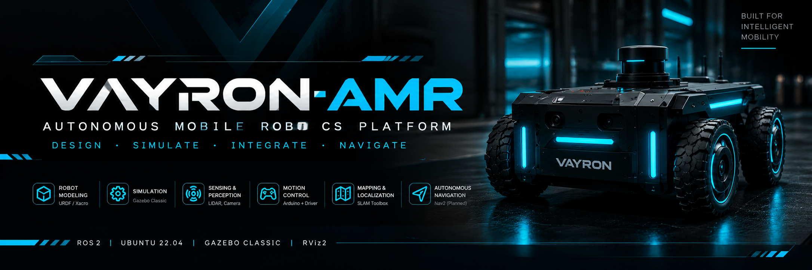

<div align="center">



<br>

# VAYRON-AMR

### AUTONOMOUS MOBILE ROBOTICS PLATFORM

**Design · Simulate · Integrate · Navigate**

A modular four-wheel differential-drive Autonomous Mobile Robot project focused on robot modeling, embedded motor control, sensor integration, simulation, mapping, and autonomous navigation using ROS 2.

<br>

[](https://docs.ros.org/en/humble/)
[](https://releases.ubuntu.com/22.04/)
[](https://classic.gazebosim.org/)
[](https://github.com/ros2/rviz)
[](https://github.com/shivamsb22/VAYRON-AMR)

[**📂 Repository**](https://github.com/shivamsb22/VAYRON-AMR) ·
[**🐛 Report an Issue**](https://github.com/shivamsb22/VAYRON-AMR/issues) ·
[**📘 ROS 2 Documentation**](https://docs.ros.org/en/humble/)

<br>

**PROJECT STATUS: ACTIVE DEVELOPMENT**

</div>

---

## 📑 Table of Contents

1. [Project Overview](#-1-project-overview)
2. [Project Objectives](#-2-project-objectives)
3. [Robot Specifications](#-3-robot-specifications)
4. [Hardware Components](#-4-hardware-components)
5. [Software and Technologies](#-5-software-and-technologies)
6. [System Architecture](#-6-system-architecture)
7. [Robot Drive Mechanism](#-7-robot-drive-mechanism)
8. [ROS 2 Workspace Structure](#-8-ros-2-workspace-structure)
9. [Installation and Setup](#-9-installation-and-setup)
10. [Build and Launch](#-10-build-and-launch)
11. [Verification and Testing](#-11-verification-and-testing)
12. [Development Roadmap](#-12-development-roadmap)
13. [Troubleshooting](#-13-troubleshooting)
14. [Engineering Principles](#-14-engineering-principles)
15. [Contributing](#-15-contributing)
16. [License](#-16-license)

---

## 🤖 1. Project Overview

**VAYRON-AMR** is an autonomous mobile robotics development platform designed to integrate mechanical systems, embedded electronics, robot modeling, simulation, perception, and navigation within a modular robotics software architecture.

The platform uses a **four-wheel differential-drive configuration**. The four wheels are arranged into two drive groups: left and right. The robot's motion is controlled by varying the direction and speed of these groups.

The project combines two major engineering domains:

- **Embedded systems:** Arduino-based motor-control logic and a four-channel motor driver.
- **Robotics software:** ROS 2 Humble, URDF/Xacro, Gazebo Classic, RViz2, sensor integration, and planned mapping and navigation capabilities.

Development follows a simulation-first approach wherever possible. Robot geometry, coordinate frames, sensor configuration, and software integration can be evaluated in simulation before equivalent behavior is validated on physical hardware.

### Key Engineering Areas

| Area | Purpose |
|---|---|
| Robot modeling | Define robot geometry, links, joints, and coordinate frames |
| Embedded control | Interface with the motor driver and manage motor commands |
| Simulation | Test robot models and supported sensors in a virtual environment |
| Perception | Integrate range-sensing data and sensor coordinate frames |
| Mapping | Develop LiDAR-based environment mapping |
| Localization | Estimate the robot's position within a map |
| Navigation | Develop goal-directed motion and obstacle-aware planning |
| Integration | Connect hardware interfaces and ROS 2 software components |

> **Development status:** This repository contains the initial robot model and launch integration. A configured sensor or a created package does not, by itself, establish that complete autonomous navigation or physical motor control is operational.

## 🎯 2. Project Objectives

- Build a modular robot model using URDF and Xacro.
- Model a four-wheel differential-drive AMR.
- Simulate the robot in Gazebo Classic.
- Visualize the robot, TF frames, and supported sensor data in RViz2.
- Integrate Arduino-based motor control through a suitable hardware interface.
- Develop reliable velocity-command and motor-control workflows.
- Integrate LiDAR data for perception and mapping.
- Develop localization and autonomous navigation using appropriate ROS 2 packages.
- Maintain reproducible build instructions and technical documentation.
- Validate simulation and physical hardware behavior separately.

## 📋 3. Robot Specifications

| Parameter | Specification |
|---|---|
| Project name | VAYRON-AMR |
| Robot category | Autonomous Mobile Robot |
| Drive configuration | Four-wheel differential drive |
| Wheel arrangement | Two drive groups: left and right |
| Embedded controller | Arduino; exact model to be confirmed |
| Motor driver | Four-channel motor driver; exact model to be confirmed |
| Motor configuration | Four DC geared motors, subject to hardware verification |
| Operating system | Ubuntu 22.04 LTS |
| Robotics middleware | ROS 2 Humble |
| Robot description | URDF / Xacro |
| Simulator | Gazebo Classic |
| Visualization | RViz2 |
| Simulated LiDAR | Gazebo ray-sensor integration configured |
| Mapping | Planned / under development |
| Localization | Planned / under development |
| Autonomous navigation | Nav2 integration planned |

Exact dimensions, motor ratings, battery specifications, communication interfaces, and measured performance will be documented after verification.

## 🔩 4. Hardware Components

The following table describes the known hardware architecture. Model numbers, electrical ratings, and component prices must be added after identifying the exact parts used.

| Component | Quantity | Purpose | Why it is used |
|---|---:|---|---|
| Arduino development board | 1 | Embedded control | Executes low-level motor-control logic and interfaces with the selected driver. |
| Four-channel motor driver | 1 | Motor actuation | Provides the required motor-control channels, subject to the driver's actual capabilities and wiring. |
| DC geared motors | 4 | Wheel propulsion | Generate the torque required to move the robot. |
| Robot wheels | 4 | Locomotion | Transfer motor torque to the ground and provide traction. |
| Chassis | 1 assembly | Mechanical structure | Supports motors, wheels, electronics, and other components. |
| Motor power source | To be confirmed | Drive-system power | Supplies the voltage and current required by the motors. |
| Voltage regulator / DC-DC converter | To be confirmed | Power regulation | Provides a suitable regulated supply when required by the electronics. |
| Wiring and connectors | As required | Electrical integration | Connect the controller, motor driver, motors, and power system. |
| LiDAR sensor | Model to be confirmed | Range sensing | Intended to provide range measurements for perception and mapping. |

### 4.1 Arduino Development Board

**Role:** Low-level embedded control.

The Arduino is intended to execute motor-control logic and interface with the selected motor driver. The exact board model and its communication interface must be documented before finalizing firmware and wiring instructions.

### 4.2 Four-Channel Motor Driver

**Role:** Motor actuation.

The motor driver switches motor power and controls the supported direction and speed signals. Its actual channel arrangement, voltage range, continuous current, and peak current must be verified against the selected motors.

A four-channel driver does not automatically guarantee that four motors can be operated at the required current. Driver specifications and wiring matter.

### 4.3 Four DC Geared Motors

**Role:** Robot propulsion.

Four motors provide the drive for the four wheels. The left and right sides are controlled as separate drive groups for differential-drive motion.

If independent wheel control or encoder feedback is required, the electrical arrangement and firmware must support it.

### 4.4 Wheels and Chassis

**Role:** Mechanical support and locomotion.

The wheels provide ground contact, while the chassis supports the motors and electronic components. Wheel diameter, wheelbase, track width, total mass, and ground clearance should be measured and recorded for accurate kinematic calculations.

### 4.5 LiDAR Sensor

**Role:** Range sensing and environmental perception.

A simulated ray sensor is configured in the Gazebo robot description. The physical LiDAR model, interface, scan frequency, range limits, and actual sensor integration must be confirmed separately.

### Electrical Integration and Safety

- Verify the motor driver's voltage and current ratings before connecting the motors.
- Check motor startup and stall current, not only nominal current.
- Do not power motors directly from Arduino GPIO pins.
- Use a suitable regulated supply for the controller when required.
- Establish a common signal reference where the selected interface requires it.
- Confirm polarity, wiring, fusing, and emergency-stop behavior before physical tests.
- Keep motor power and logic power within their respective specifications.

## 💻 5. Software and Technologies

| Technology | Role | Why it is used |
|---|---|---|
| Ubuntu 22.04 LTS | Operating system | Provides the target environment for ROS 2 Humble. |
| ROS 2 Humble | Robotics middleware | Enables communication between nodes using topics, services, and actions. |
| URDF | Robot description | Defines links, joints, and the robot's kinematic structure. |
| Xacro | Robot model authoring | Supports reusable macros and parameters in robot descriptions. |
| Gazebo Classic | Simulation | Enables testing of supported robot models and simulated sensors. |
| RViz2 | Visualization | Displays robot models, TF frames, and supported sensor data. |
| `robot_state_publisher` | TF publication | Publishes link transforms from the robot description and joint states. |
| `joint_state_publisher` | Joint-state support | Publishes configured joint states where appropriate. |
| Gazebo ROS plugins | Simulation integration | Connect supported simulated sensors and systems to ROS topics. |
| Arduino firmware | Embedded control | Implements hardware-specific motor-control behavior. |
| SLAM Toolbox | Mapping | Intended for LiDAR-based mapping integration. |
| Nav2 | Autonomous navigation | Intended for path planning and navigation behaviors. |

**Compatibility:** This project uses Gazebo Classic integration. Gazebo Classic and modern Gazebo use different integration stacks. Install plugins that match the simulator version installed on your system.

## 🧠 6. System Architecture

The intended architecture separates high-level robotics software from embedded motor control.

### 6.1 Motion-Control Architecture

```text
                 ROS 2 HUMBLE
                      |
                      v
              Velocity Commands
                  /cmd_vel
                      |
                      v
              Hardware Interface
             Serial / USB (planned)
                      |
                      v
                   Arduino
                      |
                      v
            Four-Channel Motor Driver
                      |
             +--------+--------+
             |                 |
             v                 v
       Left Wheel Pair   Right Wheel Pair
             |                 |
             +--------+--------+
                      |
                      v
                  VAYRON-AMR
```

The serial or USB link shown above represents the intended hardware interface. The actual protocol, node, and firmware implementation must be verified before this complete control chain can be considered operational.

### 6.2 Simulation and Perception Architecture

```text
                URDF / XACRO
                     |
                     v
           Robot State Publisher
                     |
                     v
                TF Frames
                     |
           +---------+---------+
           |                   |
           v                   v
     Gazebo Classic          RViz2
           |
           v
    Simulated LiDAR
           |
           v
         /scan
           |
           v
    Mapping / Localization
           |
           v
      Nav2 (planned)
```

### 6.3 Coordinate Frames

A typical mobile robot may use the following coordinate frames, depending on the actual robot description and navigation configuration:

| Frame | Purpose |
|---|---|
| `map` | Global map reference for navigation |
| `odom` | Locally continuous odometry reference |
| `base_link` | Robot body reference frame |
| `base_footprint` | Optional planar projection of the robot base |
| `laser_frame` | LiDAR sensor reference frame |

These are conventional frame names, not a guarantee that every frame is currently present in VAYRON's TF tree. The actual URDF and runtime transforms determine which frames are available.

## 🛞 7. Robot Drive Mechanism

VAYRON-AMR uses a **four-wheel differential-drive configuration**, not mecanum drive.

The left wheels form one drive group and the right wheels form the other. Changing the relative speed or direction of these groups produces the robot's motion.

| Motion | Drive behavior |
|---|---|
| Forward | Both sides move in the forward direction. |
| Reverse | Both sides move in reverse. |
| Turn left | Right side moves faster than the left side, or the sides counter-rotate for a tighter turn. |
| Turn right | Left side moves faster than the right side, or the sides counter-rotate for a tighter turn. |
| Rotate in place | Left and right sides rotate in opposite directions, if supported by the mechanical and control setup. |

The exact wheel-speed commands depend on motor wiring, wheel orientation, wheel geometry, and the selected controller implementation.

### Important Kinematic Parameters

For a differential-drive model, the following measurements are important:

- Wheel radius.
- Distance between the left and right drive groups.
- Wheel and motor orientation.
- Wheel encoder resolution, if encoders are installed.
- Wheel-speed limits.
- Robot footprint and collision geometry.

These values should be measured from the physical robot or validated CAD model before configuring an accurate controller.

## 🗂️ 8. ROS 2 Workspace Structure

The repository follows a modular package structure.

```text
VAYRON-AMR/
├── README.md
├── .gitignore
├── docs/
│   └── images/
│       └── vayron-banner.png
└── src/
    ├── vayron_description/
    │   ├── launch/
    │   │   └── vayron.launch.py
    │   ├── rviz/
    │   │   └── vayron.rviz
    │   └── urdf/
    │       └── vayron/
    │           ├── vayron.urdf
    │           └── vayron.urdf.xacro
    │
    ├── vayron_bringup/
    ├── vayron_control/
    ├── vayron_hardware/
    ├── vayron_navigation/
    └── vayron_simulation/
```

### Package Responsibilities

| Package | Responsibility |
|---|---|
| `vayron_description` | Robot links, joints, URDF/Xacro, description launch files, and RViz configuration. |
| `vayron_bringup` | Intended entry point for launching the complete robot system. |
| `vayron_control` | Intended location for motion-control nodes and differential-drive logic. |
| `vayron_hardware` | Intended location for Arduino communication and hardware interfaces. |
| `vayron_navigation` | Intended location for mapping, localization, Nav2 configuration, and related launch files. |
| `vayron_simulation` | Intended location for simulation-specific assets and launch configuration. |

Some packages currently contain ROS 2 package scaffolding only. The table documents their intended responsibilities, not a claim that their complete functionality is already implemented.

## 🛠️ 9. Installation and Setup

### 9.1 Prerequisites

- Ubuntu 22.04 LTS.
- ROS 2 Humble.
- Gazebo Classic and compatible ROS integration packages.
- Git.
- `colcon`.
- `rosdep`.

### 9.2 Install Build Tools

```bash
sudo apt update

sudo apt install -y \
  git \
  python3-colcon-common-extensions \
  python3-rosdep
```

If `rosdep` has not been initialized on the system, follow the official ROS 2 setup documentation before resolving dependencies.

### 9.3 Clone the Repository

```bash
git clone https://github.com/shivamsb22/VAYRON-AMR.git

cd VAYRON-AMR
```

The repository directory is named `VAYRON-AMR`. If your existing local workspace is named `vayron_ws`, continue using that directory for local development. The local folder name does not need to match the GitHub repository name.

### 9.4 Source ROS 2

```bash
source /opt/ros/humble/setup.bash
```

### 9.5 Install Package Dependencies

From the workspace root:

```bash
rosdep update

rosdep install \
  --from-paths src \
  --ignore-src \
  -r -y
```

If dependency resolution reports missing keys, inspect the relevant package manifests and install the correct dependencies before continuing.

### 9.6 Build the Workspace

```bash
cd ~/vayron_ws

source /opt/ros/humble/setup.bash

colcon build

source install/setup.bash
```

If the workspace has been cloned into a different directory, substitute that directory for `~/vayron_ws`.

## 🚀 10. Build and Launch

### 10.1 Launch the Robot Description and Simulation

The current description launch file is:

`vayron_description/launch/vayron.launch.py`

Run:

```bash
source /opt/ros/humble/setup.bash
source ~/vayron_ws/install/setup.bash

ros2 launch vayron_description vayron.launch.py
```

This launches the components configured in the launch file. Exact behavior depends on the installed packages, available Gazebo plugins, and the current launch configuration.

### 10.2 Inspect ROS 2 Topics

Open another terminal and run:

```bash
source /opt/ros/humble/setup.bash
source ~/vayron_ws/install/setup.bash

ros2 topic list
```

To inspect simulated LiDAR messages, if the topic is active:

```bash
ros2 topic echo /scan
```

To inspect available TF frames:

```bash
ros2 run tf2_tools view_frames
```

### 10.3 Inspect Running Nodes

```bash
ros2 node list
```

### 10.4 Important Motion-Control Note

Launching the robot model does not automatically make it drivable. Working motion control requires an appropriate controller or simulation drive plugin. Physical operation additionally requires a functioning hardware interface and compatible Arduino firmware.

Keyboard teleoperation should only be documented as operational after the relevant command path and robot response have been tested.

## 🧪 11. Verification and Testing

Validate each subsystem independently.

| Test | What to verify |
|---|---|
| Build | All required packages compile successfully. |
| Robot description | URDF/Xacro loads and the robot model is valid. |
| TF | Expected frames are connected and correctly oriented. |
| RViz2 | The correct Fixed Frame is selected and the model is visible. |
| Gazebo | The robot spawns and the configured simulation plugins load. |
| LiDAR | The expected scan topic publishes valid range measurements. |
| Motion control | Velocity commands produce the expected simulated or physical movement. |
| Hardware interface | Communication with the Arduino is reliable. |
| Mapping | SLAM produces a usable map from the supported sensor and motion inputs. |
| Navigation | Localization, planning, and navigation behaviors work together. |

Record test results, software versions, configuration changes, and known limitations as the project develops.

## 🗺️ 12. Development Roadmap

The checkboxes below distinguish initial setup work from features that still require implementation or validation.

### Robot Modeling and Simulation

- [x] Initialize the ROS 2 workspace.
- [x] Create the modular package structure.
- [x] Create the initial URDF/Xacro robot model.
- [x] Create the initial Gazebo/RViz launch integration.
- [x] Configure the simulated LiDAR integration.
- [ ] Validate all link and joint transforms.
- [ ] Validate the complete robot model and sensor alignment.

### Embedded and Motion Control

- [ ] Confirm Arduino board and motor-driver models.
- [ ] Implement and validate differential-drive control.
- [ ] Establish the ROS 2 to Arduino communication interface.
- [ ] Implement motor direction and speed commands.
- [ ] Add safe-stop and command-timeout behavior.
- [ ] Integrate encoder feedback and odometry, if supported by the hardware.
- [ ] Validate keyboard teleoperation.

### Perception and Navigation

- [ ] Validate LiDAR topic data and frame alignment.
- [ ] Integrate SLAM Toolbox.
- [ ] Configure localization and map loading.
- [ ] Integrate Nav2.
- [ ] Validate path planning and obstacle avoidance.
- [ ] Test the complete workflow on physical hardware.

## 🔧 13. Troubleshooting

| Issue | Checks and possible solution |
|---|---|
| Package not found | Source ROS 2 and the workspace's `install/setup.bash`; rebuild if necessary. |
| Build fails | Inspect the first actual compiler or dependency error and resolve it before rebuilding. |
| Robot model missing | Check the URDF/Xacro, robot description, and launch configuration. |
| TF errors in RViz2 | Check the Fixed Frame and verify that the required transforms are being published. |
| LiDAR topic missing | Check the sensor plugin, topic name, sensor frame, and Gazebo logs. |
| Gazebo plugin fails | Confirm the plugin is installed and matches the Gazebo Classic environment. |
| Robot does not move | Check whether a drive controller/plugin is configured, `/cmd_vel` is received, and the relevant motion-control implementation is active. |
| Hardware does not respond | Verify power, wiring, driver ratings, Arduino firmware, and the selected communication interface. |
| Navigation fails | Verify map availability, sensor data, transforms, odometry, localization, and navigation parameters. |

## 🧭 14. Engineering Principles

**Modularity:** Keep robot description, control, hardware, simulation, and navigation concerns separate.

**Simulation first:** Validate software behavior in a virtual environment before physical integration wherever practical.

**Verifiability:** Document completed, planned, and experimentally validated features separately.

**Electrical safety:** Respect component ratings and verify power and stopping behavior before testing.

**Reproducibility:** Keep setup instructions, dependency declarations, and configuration files version-controlled.

**Continuous improvement:** Use test results and observed failures to guide the next engineering iteration.

## 🤝 15. Contributing

Technical feedback and contributions are welcome.

1. Fork the repository.
2. Create a feature branch.
3. Make a focused change.
4. Build and test the affected packages.
5. Update documentation where necessary.
6. Open a pull request describing the change and its verification.

For bugs or feature requests, use the [GitHub Issues page](https://github.com/shivamsb22/VAYRON-AMR/issues).

## 📄 16. License

No license has been selected for this repository yet. Until a license is added, permission to reuse, modify, or redistribute the project should not be assumed.

---

<div align="center">

### VAYRON-AMR

**DESIGN. SIMULATE. INTEGRATE. NAVIGATE.**

*Engineering autonomy, one subsystem at a time.*

[Repository](https://github.com/shivamsb22/VAYRON-AMR) · [Issues](https://github.com/shivamsb22/VAYRON-AMR/issues) · [ROS 2 Humble](https://docs.ros.org/en/humble/)

</div>
